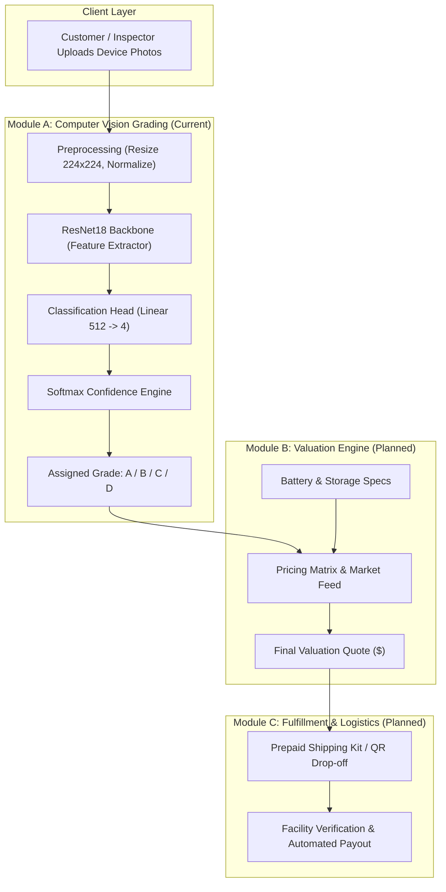

# System Context: Apple EcoLoop

> **EcoLoop** is an automated, AI-driven circular economy platform designed to streamline the trade-in, refurbishment, and grading lifecycle of Apple devices (iPhones, iPads, MacBooks).

---

## 1. Executive Summary & Problem Space

### 1.1 The Challenge
The refurbished electronics industry processes tens of millions of devices annually. However, cosmetic condition assessment has historically relied on manual human inspection:
- **Subjective & Inconsistent**: Human graders evaluate scratches, blemishes, and cracks differently, leading to inconsistent grading.
- **Customer Friction & Distrust**: Trade-in customers frequently experience "bait-and-switch" quote reductions when their device is re-evaluated at inspection facilities.
- **Operational Inefficiencies**: Manual inspection creates backlogs in high-volume recycling and refurbishment facilities.

### 1.2 The EcoLoop Solution
EcoLoop introduces an objective, AI-powered computer vision pipeline to standardize cosmetic condition grading:
1. **Automated Visual Inspection**: A deep neural network analyzes device photos to identify screen wear, enclosure dents, and glass fractures.
2. **Transparent Standardized Grading**: Categorizes devices into 4 standardized industry condition tiers (**A, B, C, D**).
3. **Instant Valuation**: Feeds the objective grade directly into a dynamic trade-in valuation engine to deliver guaranteed, friction-free quotes.

---

## 2. Platform Architecture

The EcoLoop ecosystem is structured into three modular engines:



### Module Breakdown

| Module | Name | Status | Functionality |
| :--- | :--- | :--- | :--- |
| **Module A** | **Cosmetic Vision Grader** | **Active (In Progress)** | Fine-tuned ResNet18 model classifying photos into Grades A, B, C, and D based on physical wear. |
| **Module B** | **Device Valuation Engine** | **Planned** | Computes real-time fair market trade-in prices based on: `Base MSRP - Depreciation(Age) * Grade_Multiplier * Storage_Factor`. |
| **Module C** | **Logistics & Trade-in Portal** | **Planned** | Web frontend and API services managing shipping, automated confirmation, and payments. |

---

## 3. Module A Technical Specifications

### 3.1 Model Architecture
- **Base Architecture**: ResNet18 (Residual Network 18 layers) pretrained on ImageNet-1K.
- **Strategy**: Feature Extraction via Transfer Learning.
  - Pretrained convolutional layers are frozen to leverage general visual feature extractors (edges, textures, surfaces).
  - The final classification layer (`fc`) is replaced with a 4-output linear layer mapping to `["A", "B", "C", "D"]`.
- **Input Dimension**: `(Batch, 3, 224, 224)` RGB image tensor.
- **Loss Function**: `torch.nn.CrossEntropyLoss`.
- **Optimizer**: `torch.optim.Adam` (`lr = 1e-4`).

### 3.2 Cosmetic Grading Specification Matrix

```text
               +-------------------------------------------------------+
               |                  ECOLOOP GRADING TIERS                |
+--------------+------------------+------------------+-----------------+------------------+
| Component    | Grade A (Mint)   | Grade B (Good)   | Grade C (Fair)  | Grade D (Damaged)|
+--------------+------------------+------------------+-----------------+------------------+
| Front Screen | 0 scratches      | Hairline micro-  | Deep scratches  | Cracks, spider-  |
|              | Flawless glass   | scratches (<8in) | fingernail catch| web fractures    |
+--------------+------------------+------------------+-----------------+------------------+
| Rear Glass   | Zero scuffs      | Minimal hairline | Visible scuffing| Cracked glass or |
|              | Pristine finish  | marks            | or minor chips  | missing shards   |
+--------------+------------------+------------------+-----------------+------------------+
| Frame/Bezel  | No dings/dents   | Minor pin-pricks | Visible dents / | Bent frame or    |
|              | Factory clean    | near charge port | paint peel      | heavy impacts    |
+--------------+------------------+------------------+-----------------+------------------+
| Camera Glass | Spotless lens    | Spotless lens    | Clean lens cover| Cracked lens /   |
|              | No halo/scratches| Clear capture    | Minor bezel ring| camera blur      |
+--------------+------------------+------------------+-----------------+------------------+
```

---

## 4. Current State & Technical Debt

- **Codebase Artifacts**: [`train_grading_model.py`](file:///Users/himanshuthakur/Documents/Appleloop/train_grading_model.py) handles model instantiation, training loops, checkpointing, and single-image prediction.
- **Current Data Gaps**: The project requires populating `data/train` and `data/val` with curated phone imagery.
- **Device Support**: Currently defaults to `cuda` or `cpu`. Updating to Apple Silicon `mps` will significantly speed up local Mac development.
- **Inference Integration**: Model checkpoints (`grading_model.pt`) need to be exposed via a lightweight REST service (e.g., FastAPI).
